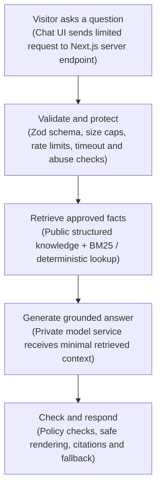
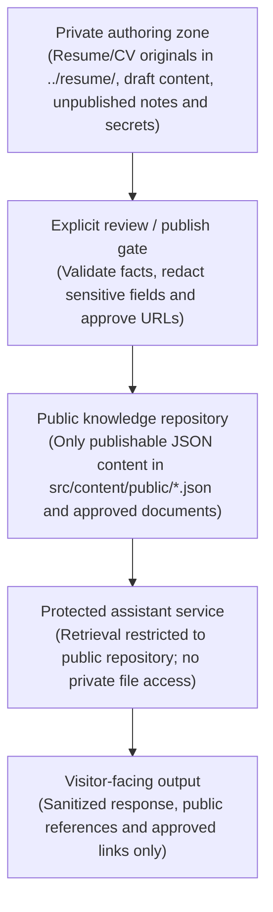
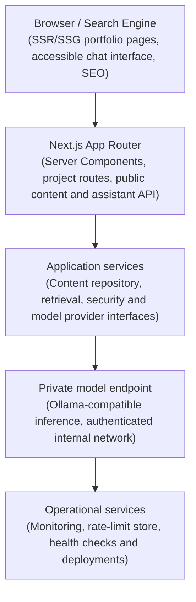
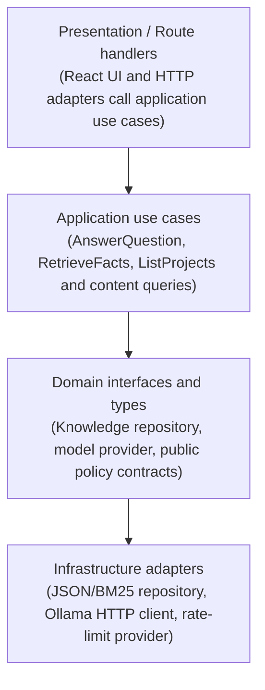
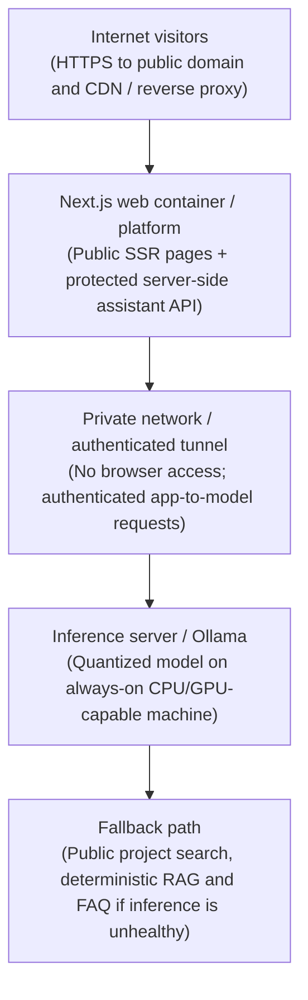

# System Architecture, RAG Pipeline, Security Model & Deployment Blueprint

This document provides the complete technical architecture, Mermaid source diagrams (corresponding to **Diagrams A–E** in the specification PDF), model benchmark & sizing analysis, security trust boundaries, and owner review procedures for **Logesh T's AI-Powered Personal Portfolio**.

---

## Diagram A — AI Assistant Request and Retrieval Flow

*All retrieval sources are approved public facts (`src/content/public/*.json`); the model cannot query private files.*

---

## Diagram B — Data Classification and Security Boundary

*No automatic private-to-public synchronization.*

---

## Diagram C — High-Level Production Architecture

*Next.js never exposes model credentials or private inference URL to the browser.*

---

## Diagram D — Feature Module Dependency Direction

*Logical dependency direction: Presentation → Application → Domain ← Infrastructure (infrastructure implements domain interfaces).*

---

## Diagram E — Deployment Topology

*Do not assume serverless hosting includes persistent model inference.*

---

## Local Open-Weight Model Evaluation & Resource Requirements

| Criterion | Recommended Default (`qwen3:1.7b`) | Alternative Lightweight (`qwen2.5:1.5b-instruct` / `llama3.2:1b`) |
| :--- | :--- | :--- |
| **Weights & License** | Open-weight Apache-2.0 (`qwen3:1.7b`) | Open-weight Apache-2.0 / Llama 3.2 Community |
| **Quantization** | `Q4_K_M` (~1.1–1.4 GB disk footprint) | `Q4_K_M` (~0.9–1.1 GB disk footprint) |
| **RAM / VRAM Footprint** | ~2.2 GB RAM (CPU inference) or 2 GB VRAM | ~1.8 GB RAM (CPU inference) |
| **Context Window Used** | 2,048 tokens (minimal retrieved facts + question) | 2,048 tokens |
| **Typical CPU Latency** | 1.5s – 4.5s on 2–4 modern vCPUs | 1.0s – 3.0s on 2–4 modern vCPUs |
| **Offline / Failure Behavior** | Automatic zero-latency deterministic BM25 RAG synthesis + Instant FAQ search tab | Automatic zero-latency deterministic BM25 RAG synthesis |

### Hosting Cost & Operational Reality
- **Free Model Weights ≠ Free Compute**: While `qwen3:1.7b` model weights are free to download and require no paid OpenAI API key, running an always-on Ollama container in production requires a VPS or dedicated host with at least **4 GB RAM and 2 vCPUs** (typically \$10–\$24/month on Hetzner, DigitalOcean, or AWS Lightsail), or an owned home/edge server connected via a private WireGuard/Cloudflare tunnel.
- **Zero-Downtime Fallback**: If the Next.js container is deployed on a low-memory host or if the Ollama container is stopped/unreachable, `answerVisitorQuestion` automatically degrades to the deterministic BM25 RAG engine (`mode: "deterministic-rag"`), answering visitor questions accurately from `src/content/public/*.json` without errors.

---

## Owner Review & Content Gate Checklist

Before publishing updates to production, verify the following owner-review items:
1. **IEEE Publication Titles**: `src/content/public/publications.json` currently uses the verified CV labels (`IEEE Publication 1` for Document `#9740832` and `IEEE Publication 2` for Document `#10113900`). Once confirmed by Logesh T, the exact paper titles can be added to `publications.json`.
2. **Public Contact Preferences**: Personal phone (`+91 73057 46782`), personal email (`logesh1892000@gmail.com`), and street address (`Pallakkapalyam, Namakkal, 637303`) are redacted across all public files. If Logesh wishes to publish a dedicated public work/contact email later, update `src/content/public/profile.json` and `src/lib/security/allowlist.ts`.
3. **Allowlisted URLs**: All external links are enforced by `src/lib/security/allowlist.ts` and validated by `src/tests/portfolio-content.test.ts`.
